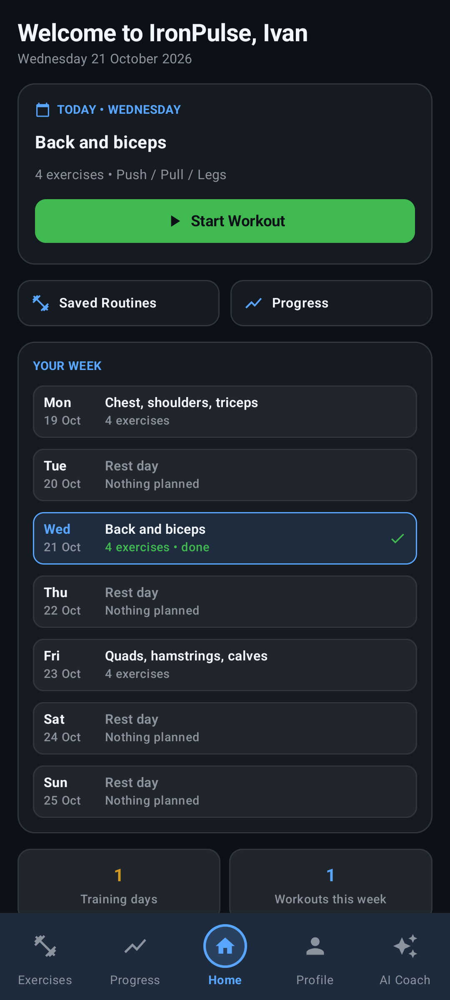
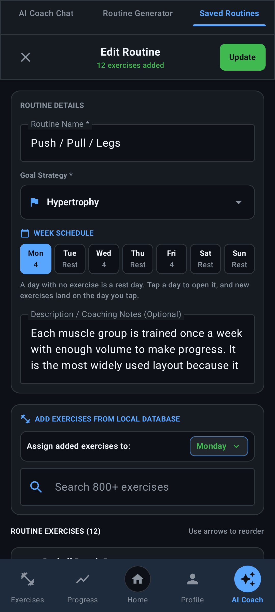
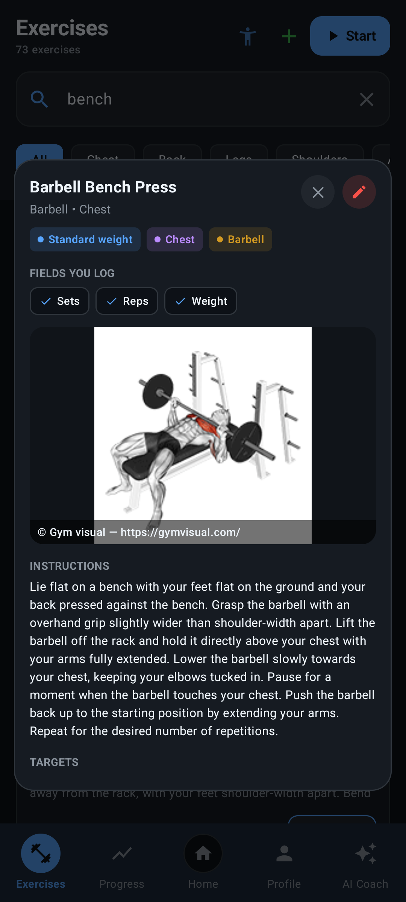
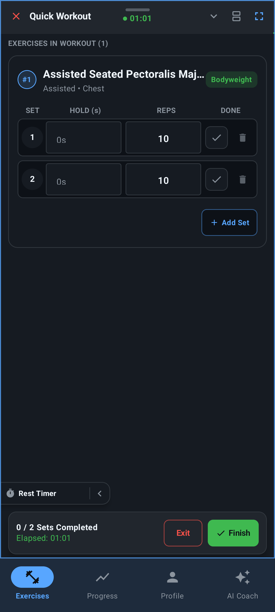
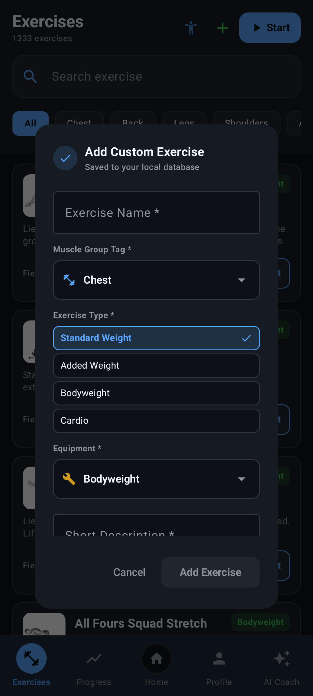
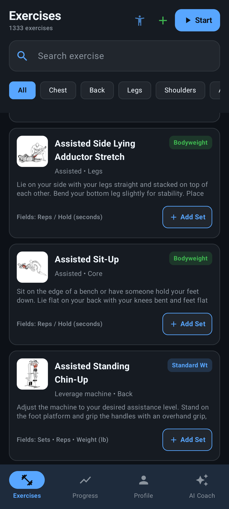
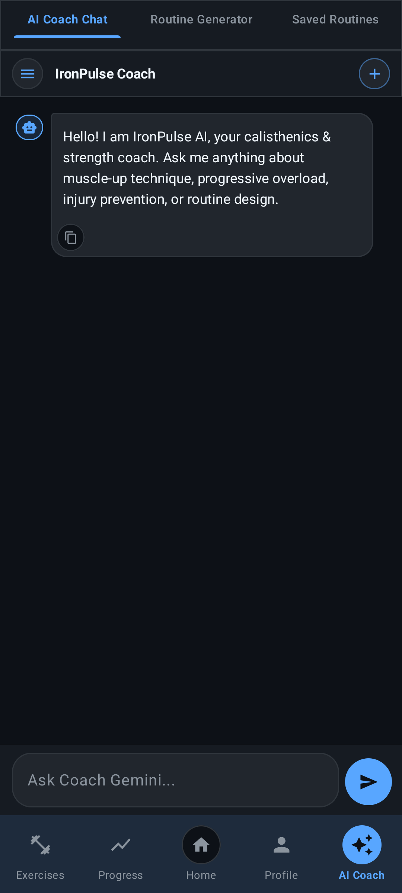
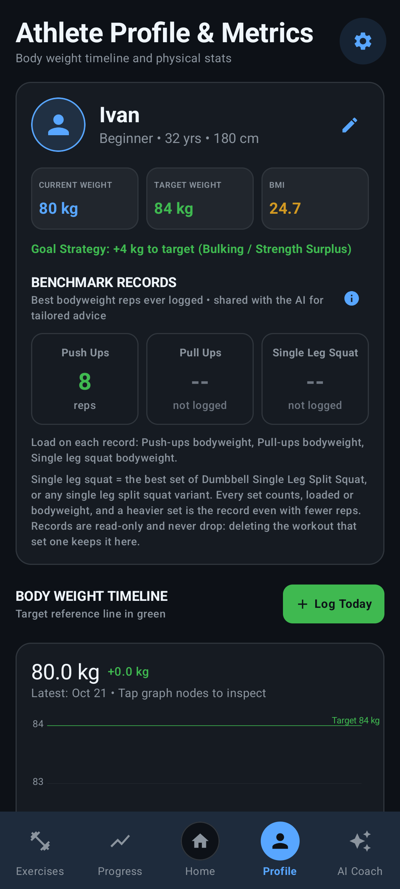

# IronPulse — Workout Logger

[](LICENSE)
[](https://kotlinlang.org)
[](https://developer.android.com)
[](https://github.com/JuggyBob/IronPulse/releases/tag/v4.3.0)

A dark-themed workout logger for strength training and calisthenics, built for the gym:
offline by default, no account, no tracking, and a 1,300+ movement catalog that streams its
animations on demand instead of shipping them in the APK. IronPulse 4.3.0 adds app-wide accent color
customization: eight presets and a custom hue / HEX / RGB picker that recolor buttons, navigation,
fields and active controls consistently. It keeps the 4.2.0 AI Coach tools and routine creation,
scheduled streak and heatmap corrections, native launcher widgets, `.ironpulse` backups, four app
themes, Liquid Glass navigation, fullscreen mode, and schedule-adherence streak.

<p align="center">
  
  
  
</p>

### What IronPulse is for

| You want to... | How IronPulse handles it |
|---|---|
| Log a workout fast | Quick workout from the Exercises tab, with rest timer and automatic set numbering |
| Run a routine | Saved routines are a week: every weekday has its own workout, and a day with nothing on it is a rest day |
| Start somewhere | Three pre-built routines with a full preview before you adopt one |
| See progress | Volume, estimated one-rep max, training days, weigh-ins plotted over time |
| Check a movement | An animation for nearly every exercise, and full instructions |
| Ask a coach | Optional AI chat with permission-gated workout retrieval, routine creation and controlled routine proposals, routine generation and monthly summaries across Google, OpenAI, Anthropic, OpenRouter, xAI or your own endpoint |
| See progress after a workout | Optional immutable AI comparison against the previous same-routine/weekday session |
| Use it from the launcher | Native Workout Streak, Weekly Workout Overview and Workout Profile widgets with independent themes |
| Make it yours | Eight accent presets or any custom color, applied consistently to buttons, navigation, fields and active controls |
| Fix something the app got wrong | A low-level editor for any exercise, plus a revert to the shipped catalog |

---

## What it does

### Home
- **Home is where the app opens.** It is the first screen after the onboarding and the first screen
  on every later launch, and it has a button of its own in the bottom navigation, between Progress
  and Profile.
- It answers the questions you have when you open a workout logger: what day it is, what is planned
  for today, whether you can start right now, what you have been doing, when you last weighed in,
  and how the week is going.
- **Today's workout** is the workout your scheduled routine assigns to today, with a **Start Workout**
  button that opens the real workout session. A rest day says so and offers another workout; a
  routine you never scheduled asks which one is the week you are following; a workout that is
  already running offers to resume it rather than starting a second one.
- **Your week** shows all seven days of the scheduled routine, with the date under each one, what is
  trained on it, and which days are rest days. Tap a training day to start it.
- **Last 7 days** as a heat map, with a **Volume / Duration** switch. Both cover the same seven
  dates, and tapping a day tells you exactly what was done on it.
- **Training days** is a lifetime count of the days you completed a qualifying workout. It is not a
  streak: a week off costs you nothing. Tap it to read exactly what counts.
- **Workout Streak** tracks adherence to your scheduled routine, not just consecutive workouts. A
  planned day counts when a finished linked session has at least one completed set; rest days do not
  break it, missed planned days do, and today's unfinished plan is pending rather than missed. The
  card shows current and best streak, a 12-week heat map, Done/Missed/Best/Next totals, and an
  animated flame that changes to ash when the streak is broken.
- **This week** in three numbers: workouts, time and volume.
- **Body weight**: the latest weigh-in, the change since the one before it, and a **Log Weight**
  button that saves through the same weigh-in the Profile page uses.
- **Last workout** with its time and its set count, and a line for the day. Tap the card and it
  expands in place: exercise names in bold, one bullet per logged set with its numbers, and a
  **See full history** link. The arrow rotates as the panel opens.
- **Customize Home from the tune button in the top-right corner.** The widget manager lists every
  card on Home with what it shows, and every available card with a short description. Add a card,
  remove one, or move it with **Up** and **Down**; removing a card only hides it, so the workouts,
  weigh-ins and routines behind it are untouched. You can still long-press a card and drag it: the
  other cards move aside live so the gap under your finger is the new order. Selection, order and
  customizations are saved together and survive restarts, and a widget added by a later update is
  inserted rather than dropped. Removing every card leaves a clear empty state with **Add widgets**.
- **Motivation Photo** puts a picture from your gallery on Home. It uses Android's photo picker,
  copies the image into app-private storage and centre-crops it to the card's 16:9 shape, so
  deleting the original from the gallery does not break it. Replace or remove it from the card or
  the manager; a missing or unreadable copy shows a placeholder with **Choose another** instead of
  a broken image.
- **Weekly Goal** counts this week's finished workouts against a target of 1 to 7, set from the
  card's tune button or the manager.
- **Settings → Home Widgets → Restore Default Home Widgets** brings back the original eight-card
  dashboard. The confirmation spells out exactly what is discarded — selection, order, weekly
  target, photo and its app-private copy — and that it cannot be undone; **Cancel** leaves
  everything as it was. Workouts, weigh-ins, routines, the profile, the exercise library and every
  other setting are not touched. **Delete App Data** also clears the widget layout and saved widget
  photos.

<p align="center">
  
</p>

### Android home screen widgets
Three real launcher widgets are registered separately from the in-app Home cards and work even when
the matching Home card is hidden:
- **Workout Streak (2x2)** shows the current and best schedule-adherence streak with a live flame or
  a burnt-out flame. Tapping it opens Home and scrolls to the streak card when that card is visible.
- **Weekly Workout Overview (4x2)** shows seven binary training days, today's scheduled workout (or
  rest day), and a **Start workout** / **Start another workout** action. The action uses the same
  routine start and Saved Routines navigation as the in-app Today's Workout card.
- **Workout Profile (4x2)** shows name, weight, height and BMI from the same merged profile and BMI
  calculation as the Profile tab. Tapping it opens Profile.

Each widget has its own **Light**, **Dark**, **AMOLED Dark** or **IronPulse** appearance under
**Settings -> Android Home Screen Widgets -> Widget appearance**. The choice is independent per
widget, previews use the same palette tokens as the app, AMOLED uses true black, and installed
widgets refresh immediately. Widgets update after workout completion, routine/profile/theme edits,
imports, app start, boot and timezone changes, with one lightweight midnight alarm for the rolling
week.

### Routines
- A routine is a **week of seven days**, one slot per weekday. A day with no exercise in it is a
  **rest day** — there is no separate rest flag to keep in step with the exercises.
- The routine editor is a **week planner**: all seven weekdays are shown with how many exercises
  each one holds, and tapping a day opens it. New exercises land on the day that is open.
- **The week can start on Monday or on Sunday**, in Settings. It decides where a week is displayed
  and where a sequence of workouts with no day of its own begins. It never moves a workout that
  already sits on a weekday.
- **Each routine entry can carry its own rest default.** Set 0 to 600 seconds in the exercise panel;
  a non-zero default starts the rest timer when you tick a set, while 0 keeps it manual. The value
  belongs to that entry, not to the shared exercise, so the same movement can rest differently in
  two plans. Routines saved before this change keep the manual timer.
- You are never limited to the plan. Any saved workout can be started on any day, and the week is
  a recommendation rather than a restriction.

<p align="center">
  
</p>

### Exercise library
1,333 movements seeded into a local SQLite database — every exercise with its equipment, muscle
group, body part, target muscles and coaching instructions. Body parts and targets are stored in one
Title Case vocabulary shared by the dataset, the editor and the detail dialog, so `Chest` and
`Pectorals` mean the same thing everywhere. Instructions are shown as one step per sentence or line
rather than as a paragraph. The animation GIFs are **streamed and cached**, not bundled, so the app
stays small and an exercise you never open costs nothing.

<p align="center">
  
</p>

### Logging
- **Quick workouts** — tap *Start*, add exercises, log sets. A live tray keeps the session in view.
- **Routine workouts** — follow a saved split day by day.
- **Every set type is a first-class citizen.** Standard weight, added weight, pure bodyweight and
  cardio each have their own fields, their own column headers and their own Progress-tab
  description. Cardio logs minutes and distance and never asks for a barbell weight.
- Rest timer with vibration and sound, autoplaying or hidden into the border.
- Every exercise is editable — including the shipped library — so a row with wrong fields can be
  fixed instead of being lived with. Library edits ask first and survive catalog updates.
- **The workout is saved while you do it.** A small cloud sits inside the workout-time box, left of
  the timer; it pops a check mark when a save lands and settles into a lighter green. The interval
  is yours to choose in **Settings → Autosave interval** (5, 10, 15, 30 or 60 seconds, default 10).
  If the app is closed by accident, the next launch offers the workout back with every set, every
  number and the elapsed time intact, to continue or to discard.
- **Name your workout** by tapping its title, so a session is easy to find in the history later.
- **Set a default added weight** for an exercise in a split — tap the exercise name in the routine
  editor and the panel opens, out of the way until you ask for it. The split starts with that load
  already filled in.

<p align="center">
  
</p>

### Your own exercises
- Attach a photo or video of your own variation. It replaces the built-in animation, so you see
  *your* movement rather than someone else's.
- The pick is copied into the app's own storage, so it keeps working after a restart rather than
  expiring with the gallery's permission.
- Saving an exercise says so: a tick draws itself, and the editor stays open until you close it.
- Exercises the AI created are always labelled **AI generated**, never as your own.

<p align="center">
  
</p>

### Themes, Liquid Glass and fullscreen
- **Four complete looks:** IronPulse, Dark, Light and AMOLED Dark. The selector is at the top of
  Settings, applies immediately, persists across restarts, and falls back to IronPulse for unknown
  stored values. Charts, activity heat maps, the muscle map, dialogs, buttons and the Liquid Glass
  lens all draw from the same semantic palette.
- **Accent color customization.** **Settings -> Preferences -> Accent Color** offers IronPulse Blue,
  Purple, Cyan, Green, Orange, Red, Pink and Yellow, plus a **Custom Color** picker with a circular
  hue ring, saturation/brightness square, live preview and synchronized HEX / R/G/B inputs. The
  chosen accent applies immediately to primary buttons, the selected navigation item and tabs,
  focused fields and cursors, checkboxes, sliders, progress indicators and selected chips. It
  persists across restarts and theme changes, and the original IronPulse blue remains the default.
- **Liquid Glass navigation.** The bottom dock floats over the page instead of sitting in an opaque
  reserved strip. On Android 12+ it captures and blurs the content behind it; Android 7.1-11 use the
  documented translucent fallback. Hold the dock to magnify neighbouring tabs, then release over one
  to navigate. Normal taps still work, and releasing outside the dock does nothing.
- **Fullscreen Mode** is on by default. It hides the status and navigation bars and reserves only the
  actual display-cutout path on API 33+; turning it off restores both bars and `safeDrawing` insets.
  The setting is independent of the theme and Liquid Glass.
- **Readable floating surfaces.** Settings popups, the Home widget manager and the dock use
  content-appropriate glass opacity so labels and controls stay legible in every theme.

### Progress
- Volume, estimated one-rep max, max reps, training days and a 12-month activity heatmap built from
  local calendar days, so daylight-saving changes cannot move a workout to the wrong square.
- Per-exercise analysis with an interactive graph you can tap to inspect any point.
- Weigh-ins on the Profile tab, plotted over time, feeding every body-weight calculation in the app.
  The full history opens in place with a slide and shares one card, with a divider between entries.
- Units follow your preference everywhere; the storage unit never changes and no history is ever
  rewritten when you switch.
- **A set keeps the body weight it was done at.** Weighing in today does not rewrite what last
  month's pull-ups weighed, so the isolated weight tags and the history stay true.
- **One definition of volume.** The heat map and the Progress chart count the load actually lifted,
  so two screens never disagree about the same week.

<p align="center">
  
</p>

### AI (optional, bring your own provider)
The app is fully usable without AI. Choose Google, OpenAI, Anthropic, OpenRouter, xAI or your own
OpenAI-compatible endpoint, add a key where the service needs one, and you get:
- Paste any workout in any format and get a structured routine back.
- Describe a goal and get a plan built from movements the app actually has.
- **The AI plans a week.** The generated routine is scheduled onto the days of the week: a weekday
  the answer named is kept, and a workout with no weekday named is laid out from the start of your
  week. The app applies those rules itself, so the schedule is the same whatever the model returns.
- A database-aware coach chat. After you enable **Allow AI Coach to access workout data** in
  Settings, it can retrieve recent completed workouts, your current weekly schedule, the exercise
  catalog and one exercise's completed history through four bounded, read-only tools. It answers
  progress and frequency questions from those records instead of guessing.
- **Controlled routine changes.** The coach may prepare one routine substitution, including an
  AI-generated exercise when no catalog movement fits. The change appears as an approval card in
  the conversation and is applied only after you press **Grant permission**; rejection changes
  nothing. The approval is one-time, scoped to the displayed change, and expires if the routine or
  the permission changes.
- Automatic creation of missing movements, including target muscles, secondary muscles and
  short coaching-cue instructions.
- **Post-workout AI summaries.** When enabled independently in Settings, finishing a quick or
  routine workout compares it with the previous comparable session, using the stable routine id and
  weekday where available and clearly disclosing partial matching for quick workouts. The exact
  Markdown result is saved against that workout and shown in a popup. Saved summaries are immutable
  and reopen from Workout History without another AI request.
- **One AI layer for every provider.** The coach, routine generator, parser and monthly summary use
  the same prompts and the same tools, so changing provider does not change what the app can do.
- **A model selector with live discovery.** Load the provider's catalog, refresh it, or type a model
  id yourself; the choice is stored per provider. Capability badges say whether a model reports
  native tool calling, and **Auto**, **Native only** and **Text fallback** control how tools are
  offered.
- **AI data access is off by default.** Until you enable it in Settings, the coach is not registered
  any personal-data tool and receives no hidden workout context. The setting is enforced when a tool
  is dispatched, not merely described in the prompt. It cannot run SQL, touch files, make network
  calls or execute code, and it cannot modify workouts, your profile, measurements, settings, the
  catalog or history. A settings popup lists exactly what is retrievable and what is prohibited.
- **A custom endpoint is opt-in.** Its URL is validated, plain HTTP is limited to loopback or a
  private-network host, and the first use shows a privacy/security warning naming the exact
  endpoint. The key goes only to that endpoint, redirects are not followed and TLS checks are never
  disabled. A local server may need no key.
- **Data sharing is off by default.** No part of your profile is sent with a request until you turn
  it on in Settings, and the setting says plainly what is and is not sent.
- Generated routines are short and readable: every prescription is just `4 sets x 8 reps`, with the
  load left to you.

<p align="center">
  
</p>

### Profile & metrics
Body-weight timeline with a target reference line, BMI, goal strategy, and three read-only
benchmark records (push-ups, pull-ups, single-leg squat) with the load each was done at. Those are
handed to the AI so a progression is based on what you actually lifted.

**Profile picture:** tap the avatar and pick one from your gallery. The copy is kept in the app's own
storage, so it keeps working even after you delete the original from your gallery.

<p align="center">
  
</p>

### Updates and what's new
- **Check for updates** is in Settings. It looks at the official releases of this repository on
  GitHub and tells you whether the build you are running is the newest one.
- **Check for updates on app start** (on by default) does the same lookup quietly at launch. If a
  newer release exists, a short prompt shows its version and changes with a **Download** button.
  **Close** brings it back next start; **Close and do not show again** suppresses it until the app
  is updated, and the prompt waits for onboarding or a saved workout to be dealt with first.
- When there is a newer release, the app can download it and hand it to the Android installer. The
  download is checked against the checksum GitHub publishes, and against the package inside the
  file, before the installer ever sees it.
- **Android still asks you to confirm.** From Android 8 you also have to allow IronPulse to install
  packages, and the app takes you to that setting and checks again when you come back.
- **About IronPulse** shows the version you are running, the newest published version and what
  changed in it, taken from the official release notes. A copy is kept so it is still there without
  a network.

---

## Privacy

- **No account. No tracking. No analytics.**
- Every workout, weigh-in and routine lives in a SQLite database on your device.
- AI features are optional. Hosted providers require your own API key; a local OpenAI-compatible
  endpoint may not. Keys stay in app-private DataStore and are sent only to the provider that owns
  them.
- Athlete data sharing is **off** until you explicitly enable it. AI Coach workout-data access is a
  separate switch, also off by default; disabling it removes the personal-data tools and invalidates
  pending routine approvals.
- **Widget photos stay on the device.** A picture chosen for the Motivation Photo widget is copied
  into app-private storage and the gallery original is never modified. The copy is deleted when the
  widget is removed or its photo replaced, when the Home widgets are restored to defaults, and by
  **Delete App Data**, which also clears the widget layout and customizations.
- **Delete App Data** in Settings wipes everything on the device.
- The update check reads the public releases of this repository. **No token and no credential is
  built into the app**, and nothing is sent anywhere else.

### Backup and restore
- **Export a portable `.ironpulse` file** from Settings -> Data Management. It contains the complete
  user-data state: profile and onboarding, workouts and every set, exercise history, custom and
  AI-generated exercises, edited library exercises, routines and materialized schedules, weigh-ins,
  all AI conversations and messages (including routine-approval metadata), saved Gemini summaries,
  post-workout AI summaries, Home widget configuration and the Motivation Photo, the three
  independent Android widget themes, the exportable preferences, and the AI-access/summary toggles.
- **The archive is versioned and checksummed.** `manifest.json` carries a container format version, a
  separate data-schema version, the source app version, export time, section paths and record counts.
  `checksums.json` carries SHA-256 for every payload entry. Import verifies the whole archive before
  touching the destination.
- **Import replaces, it does not merge.** The destructive confirmation names the backup version,
  creation time, size and category counts. After confirmation, destination user data is replaced by
  the backup's data even when a category is empty. API keys, the destination profile picture and its
  path are preserved; exercise images/GIFs are excluded and the restored exercise uses the existing
  missing-media fallback.
- **Failure safety.** Room replacement is transactional. DataStore, the Home photo and preference
  state are staged and verified, with a rollback snapshot of the previous user data. The app reports
  that the previous data was restored only when rollback succeeds.
- **Future compatibility.** Older data schemas have a centralized migration path; newer/unknown
  schemas are rejected before any write. The v1 compatibility fixture and tests must keep importing.
  The format and migration rules are documented in `docs/BACKUP_FORMAT.md`,
  `docs/BACKUP_ARCHITECTURE.md` and `docs/BACKUP_MIGRATION_GUIDE.md`.

---

## Development Methodology & Transparency

- **Maintainer Role:** System architecture, product specifications, domain model design, API
  integrations, prompt engineering, and quality assurance/testing.
- **Code Generation:** Built with AI assistant workflows.

---

## Tech stack

| Component | Technology |
|---|---|
| **Language** | Kotlin (100%) |
| **UI** | Jetpack Compose + Material 3, portrait-only (locked in the manifest) |
| **Architecture** | MVVM — Compose screens → `MainViewModel` → `FitnessRepository` → Room DAOs |
| **Database** | Room (SQLite), schema v15, versioned migrations |
| **Preferences** | DataStore |
| **Backup format** | `.ironpulse` ZIP with manifest, independent format/data-schema versions, SHA-256 checksums and forward migrations |
| **Async** | Coroutines + Flow |
| **Images** | Coil (animated GIF + still-frame loaders) |
| **Video** | Media3 / ExoPlayer |
| **AI** | Provider-independent layer in `data/ai` (Google, OpenAI, Anthropic, OpenRouter, xAI, custom OpenAI-compatible endpoint), bring your own key |
| **Updates** | GitHub Releases REST API (`ReleaseApi`), no token, the official repository only |
| **Min SDK** | 24 (Android 7.1) · **Target SDK** 36 |

---

## Getting started

### Requirements
- JDK 17 or newer (Android Studio Ladybug / 2024.2+ bundles one)
- Android SDK with platform 36
- A device or emulator on Android 7.1 (API 24) or newer

### Setup
1. **Clone**
   ```bash
   git clone https://github.com/JuggyBob/IronPulse.git
   cd IronPulse
   ```
2. **Point the SDK at your machine.** Android Studio does this for you; otherwise copy
   `local.properties.example` to `local.properties` and set `sdk.dir`.
3. **Build**
   ```bash
   ./gradlew assembleDebug
   ```
   The APK lands in `app/build/outputs/apk/debug/`.
4. **Install on a device**
   ```bash
   ./gradlew installDebug
   ```

### AI provider (optional)
The app works fully without one. To enable the AI features, open **Profile & Settings → AI Fitness
Coach**, choose a provider and save its key (a local OpenAI-compatible endpoint may not need one).
Keys are stored on the device and are never committed to the repository. A build-time Google key
can still be supplied through `.env`; copy `.env.example`, fill it in, and keep `.env` gitignored.

### Running the tests
```bash
./gradlew testDebugUnitTest      # 750 JVM unit tests across 89 classes
./gradlew recordRoborazziDebug   # regenerate reference screenshots
```

---

## Download

Prebuilt APKs are attached to the
[releases page](https://github.com/JuggyBob/IronPulse/releases).

| Version | File |
|---|---|
| **v4.3.0** | [`IronPulse4.3.0-release.apk`](https://github.com/JuggyBob/IronPulse/releases/download/v4.3.0/IronPulse4.3.0-release.apk) |
| v4.2.0 | [`IronPulse4.2.0-release.apk`](https://github.com/JuggyBob/IronPulse/releases/download/v4.2.0/IronPulse4.2.0-release.apk) |
| v4.1.0 | [`IronPulse4.1.0-release.apk`](https://github.com/JuggyBob/IronPulse/releases/download/v4.1.0/IronPulse4.1.0-release.apk) |
| v4.0.0 | [`IronPulse4.0.0-release.apk`](https://github.com/JuggyBob/IronPulse/releases/download/v4.0.0/IronPulse4.0.0-release.apk) |
| v3.0.0 | [`IronPulse3.0.0-release.apk`](https://github.com/JuggyBob/IronPulse/releases/download/v3.0.0/IronPulse3.0.0-release.apk) |
| v2.0.1 | [`IronPulse2.0.1-release.apk`](https://github.com/JuggyBob/IronPulse/releases/download/v2.0.1/IronPulse2.0.1-release.apk) |
| v2.0.0 | [`IronPulse2.0.0-release.apk`](https://github.com/JuggyBob/IronPulse/releases/download/v2.0.0/IronPulse2.0.0-release.apk) |
| v1.1.1 | [`IronPulse1.1.1-release.apk`](https://github.com/JuggyBob/IronPulse/releases/download/v1.1.1/IronPulse1.1.1-release.apk) |
| v1.1.0 | [`IronPulse1.1.0-release.apk`](https://github.com/JuggyBob/IronPulse/releases/download/v1.1.0/IronPulse1.1.0-release.apk) |
| v1.0.1 | [`IronPulse-v1.0.1.apk`](https://github.com/JuggyBob/IronPulse/releases/download/v1.0.1/IronPulse-v1.0.1.apk) |
| v1.0.0 | [`IronPulse-v1.0.0.apk`](https://github.com/JuggyBob/IronPulse/releases/download/v1.0.0/IronPulse-v1.0.0.apk) |

Every release is signed with the same key, so installing a newer version is an upgrade in place and
your history stays where it is. Each release also carries a `.sha256` file next to the APK, so you
can check that what you downloaded is what was published.

Requires Android 7.1 (API 24) or newer.

---

## Project layout

```
IronPulse/
├── app/
│   ├── src/main/
│   │   ├── assets/exercises.json     # 1,333-movement catalog seed
│   │   ├── java/com/example/
│   │   │   ├── data/                 # Room entities, DAOs, repository, seeders, backup codec
│   │   │   ├── ui/
│   │   │   │   ├── components/       # Dialogs, editors, charts, sheets
│   │   │   │   ├── screens/          # Home, the other tabs and onboarding
│   │   │   │   ├── theme/            # Colours, type, Material 3 theme
│   │   │   │   └── viewmodel/        # MainViewModel — the single source of truth
│   │   │   └── util/                 # Coil loaders, media store, timers
│   │   └── res/                      # Icons, strings, themes, backup rules
│   └── src/test/                     # 750 JVM tests (Robolectric + JUnit)
├── docs/screenshots/                 # Images used by this README
├── gradle/wrapper/                   # Pinned Gradle distribution
├── .github/                          # Issue & PR templates, CI workflows
├── CHANGELOG.md
├── CONTRIBUTING.md
├── SECURITY.md
├── LICENSES/                         # preserved historical and new license texts
└── LICENSE                           # licensing index (CC BY-NC-SA 4.0 + PolyForm)
```

---

## Credits

- Exercise animations are © [Gym visual](https://gymvisual.com/) and stream from the
  [hasaneyldrm/exercises-dataset](https://github.com/hasaneyldrm/exercises-dataset) repository. The
  required attribution is shown on-screen next to every dataset animation.
- Built with [Jetpack Compose](https://developer.android.com/jetpack/compose) and
  [Material 3](https://m3.material.io/).

---

## Contributing

Bug reports, feature requests and pull requests are all welcome — see
[CONTRIBUTING.md](CONTRIBUTING.md). Security issues go through
[SECURITY.md](SECURITY.md) instead of a public issue.

---

## License

IronPulse has a licensing boundary; it is not under one set of terms across its whole history.

- Code and assets at or before the 3.0.0 boundary remain under the **Creative Commons
  Attribution-NonCommercial-ShareAlike 4.0 International Public License (CC BY-NC-SA 4.0)**. The
  complete preserved text is [LICENSES/CC-BY-NC-SA-4.0.txt](LICENSES/CC-BY-NC-SA-4.0.txt).
- New standalone source files authored after the verified `v3.0.0` tag are under the **PolyForm
  Noncommercial License 1.0.0**. This includes the Liquid Glass and workout-streak modules and the
  user-data export/import implementation. The official text is
  [LICENSES/POLYFORM-NONCOMMERCIAL-1.0.0.txt](LICENSES/POLYFORM-NONCOMMERCIAL-1.0.0.txt).
- Modifications inside pre-existing files are not relicensed as a whole and remain under
  CC BY-NC-SA 4.0, including its ShareAlike requirement.
- Third-party components keep their own licenses.

The official boundary is tag `v3.0.0` at commit `784fc4d3553dc286db85e576641e4f067993f577`
(version name `3.0.0`, version code `7`). [LICENSE](LICENSE) is the index; the evidence and full
file scope are in [LICENSES/LICENSE-BOUNDARY.md](LICENSES/LICENSE-BOUNDARY.md).

**Not an official product of Google, Gym visual, or any exercise dataset author.**
