# IronPulse 5.0.1

[](LICENSE)
[](https://kotlinlang.org)
[](https://developer.android.com)
[](https://github.com/JuggyBob/IronPulse/releases/tag/v5.0.1)
[](https://github.com/JuggyBob/IronPulse)

**IronPulse is a local-first strength and calisthenics trainer for Android.** It keeps the plan, the
workout and the numbers in one place: a 1,334-movement exercise library, reusable Routines arranged
into a weekly Schedule, a focused workout interface with warm-up sets and drop sets, progress
analytics, body-weight tracking and an optional AI coach that works with the provider you already
use. No account, no tracking, and no server-side copy of your training data.

IronPulse 5.0.1 is a bug-fix update to 5.0.0. It fixes onboarding and backup recovery: `.ironpulse`
files are selectable from any folder again, connecting a cloud folder offers the newest existing
backup before writing anything, restoring during onboarding finishes setup instead of asking for
metrics, and cloud backups wait for a saved profile. The full 4.4.0 → 5.0.1 record is in
[CHANGELOG.md](CHANGELOG.md).

IronPulse 5.0.0 itself was the first public release since 4.4.0 and the largest update in the
project's history. It replaced the multi-day routine model with **Routines + Schedules**, rebuilt the
active workout around an exercise selector, added **drop sets**, **warm-up sets** and per-set rest
overrides, gave every exercise an explicit field configuration, and added **cloud-folder backups** and
**eight selectable launcher icons**.

<p align="center">
  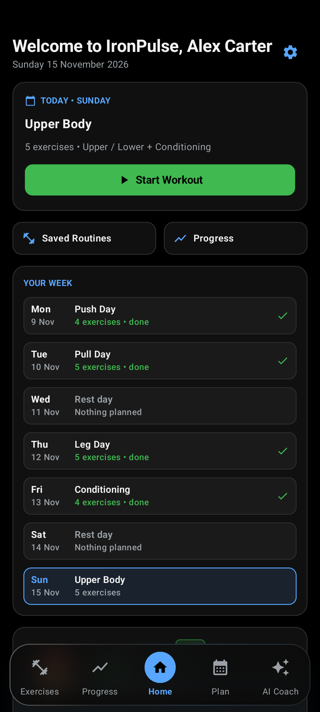
  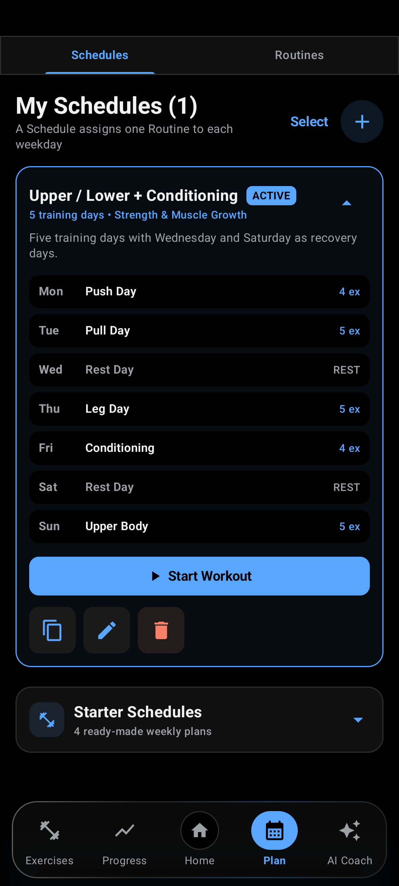
  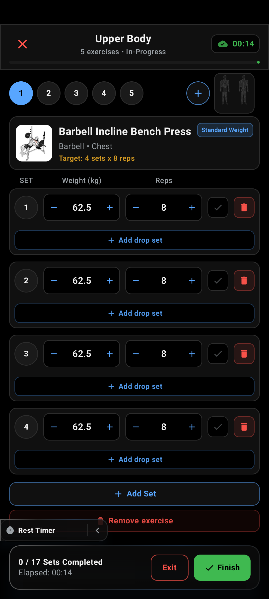
</p>

---

## What is new in 5.0

- **Plan is the new home for training structure.** A Routine is one workout. A Schedule is a week of
  seven weekday slots. The active Schedule drives Home and the streak.
- **A rebuilt workout interface.** Exercise selector, one focused exercise, unified set rows,
  per-set rest and warm-up options, drop-set branches and a whole-workout body-part map.
- **Drop sets and warm-up sets are persisted data**, not labels. They survive drafts, history,
  progress, AI context, backups and restarts.
- **Explicit exercise fields.** `reps`, `weight`, `addedWeight`, `holdSeconds`, `timeSeconds` and
  `distanceKm`, configured per exercise. The 1,334-row catalogue was audited field by field.
- **Cloud-folder backups** through Android's document picker, with automatic verified backups and
  five-file retention.
- **Eight launcher icons** with adaptive, round and legacy variants, plus a Recents task icon that
  follows the choice.
- **A safer upgrade.** Room 15 → 19 and backup schema 2 → 6, with 4.4 multi-day routines converted
  to Routines plus a Schedule and completed history left intact.

## What IronPulse is for

| You want to… | How IronPulse handles it |
|---|---|
| Plan a week | Build one Routine per workout, then assign them to the seven weekday slots of a Schedule |
| Start today's session | Home reads the active Schedule and offers the planned workout, or says it is a rest day |
| Log a workout fast | Quick Workout, with the same set rows, rest timer and automatic set numbering |
| Train with intensity | Warm-up sets, drop sets, per-set rest overrides and an inherited default |
| Follow a movement | An animation for nearly every exercise, step-by-step instructions, fields and a muscle map |
| See progress | Volume, estimated 1RM, max reps, training days, a 12-month heat map and body-weight trends |
| Check one exercise | Exercise Progression with an isolated-weight tag and an optional AI monthly summary |
| Ask a coach | Optional chat with permission-gated workout tools and controlled routine proposals |
| Back up safely | Portable `.ironpulse` archives, or automatic verified copies in a folder you choose |
| Make it yours | Four themes, eight accent presets or a custom colour, Liquid Glass, fullscreen and eight icons |
| Use it from the launcher | Workout Streak, Weekly Workout Overview and Workout Profile widgets with independent themes |

---

## How the app is organized

The bottom dock has five destinations:

| Destination | What it is |
|---|---|
| **Home** | Today's planned workout, the week, streak, recent activity, body weight and last workout |
| **Exercises** | The 1,334-movement library, search/filter, exercise details, custom exercises and Quick Workout |
| **Progress** | Activity heat map, body-weight timeline, weigh-ins and Exercise Progression |
| **Plan** | Schedules and Routines, with the full editor for both |
| **AI Coach** | AI chat and the Routine Generator, both optional |

Settings opens from the gear on Home and contains the athlete profile, appearance, user preferences,
AI tools, data management, updates and support.

---

## Plan: Schedules and Routines

A **Routine** is one reusable workout: one ordered exercise list with its own sets, reps, load, rest,
drop-set defaults and per-main-set values. It is not a week and it is not tied to a weekday.

A **Schedule** is a named week of seven stable weekday slots. Each slot references a Routine or is a
rest day. The same Routine can be used on several days, and editing it immediately changes every
weekday that references it.

- **One active Schedule** drives Home's Today card, the week strip, Start Today, the adherence streak
  and the Android widgets.
- **Goal strategy** lives on the Schedule. Strength & Muscle Growth, Strength & Power, Hypertrophy &
  Muscle Growth, Calisthenics Mastery and Conditioning & Fat Loss each explain what they change. A
  started workout captures the strategy at that moment.
- **Start any weekday** from the Schedule without changing the active plan. Home can also start
  another saved Routine on a rest day.
- **Four starter templates:** Three-Day Full Body, Four-Day Upper/Lower, Five-Day Push Pull Legs and
  Six-Day Push Pull Legs. Copying one creates independent Routines and a Schedule.
- **Reference-safe deletion.** Deleting a Routine turns every weekday that used it into a rest day;
  completed sessions and logged sets are never deleted with the plan.
- **Batch selection** is available for both Routines and Schedules.

<p align="center">
  
  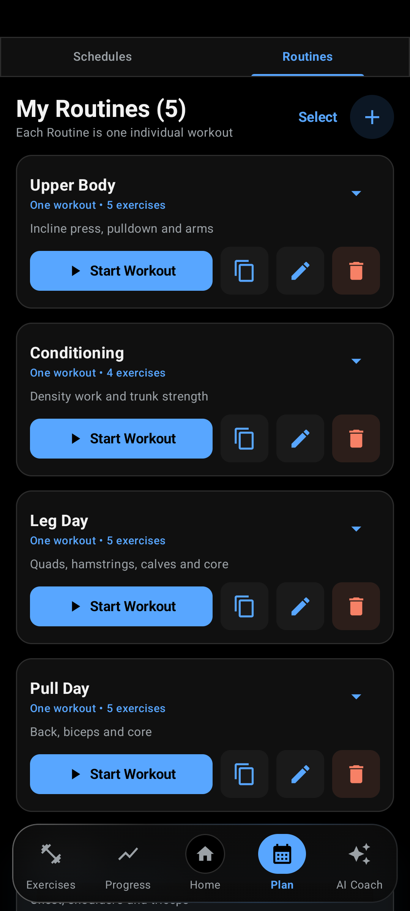
</p>

<p align="center">
  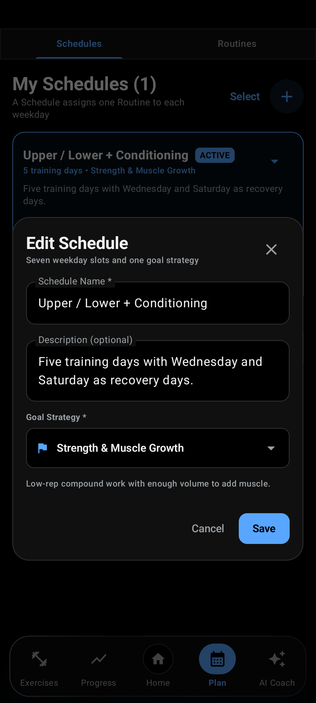
  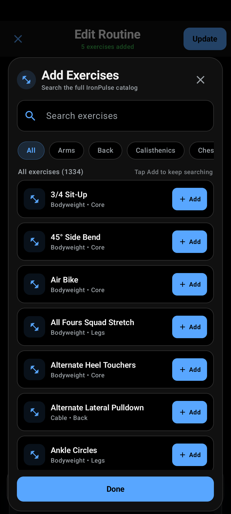
</p>

### Editing a Routine

The editor keeps the Routine details at the top and one card per exercise. A card exposes the sets,
the reps and the **Set defaults & drop sets** panel. There you can set a different target for every
main set, add one or more drop sets to a main set and choose a rest duration for each.

The exercise name opens the same read-only detail sheet used during a workout: media, instructions,
tracked fields, targets and the body map. Editing stays in the exercise editor, so a routine cannot
accidentally rewrite the shared catalogue entry.

<p align="center">
  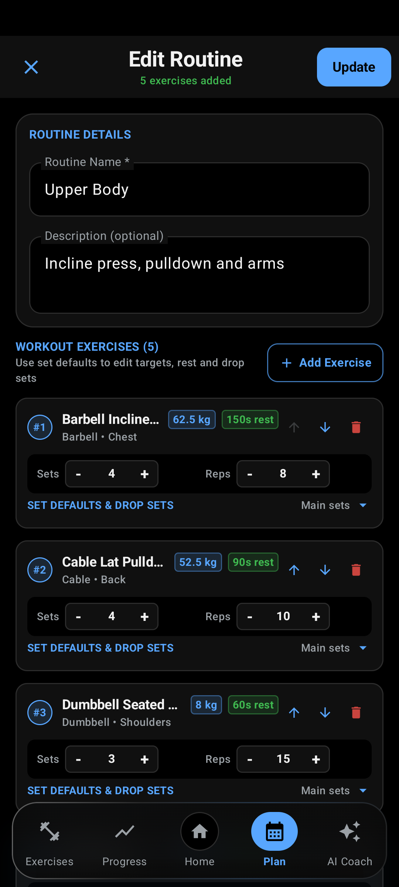
  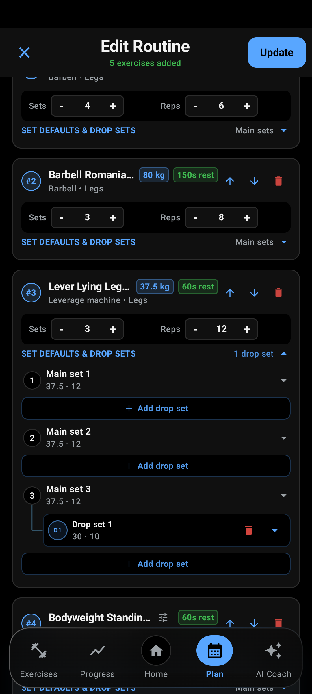
</p>

### Upgrading from 4.4.0

Each legacy multi-day routine becomes one Schedule plus one standalone Routine per distinct workout
day. Identical days inside the same program share one Routine. The old row is retained at
`modelVersion = 1` so historical session links keep resolving, but the new UI only shows the
single-workout rows. The old active routine is promoted to the migrated Schedule as soon as the
conversion finishes.

---

## Workout logging

### Routine workouts

Starting a Routine opens the exercise-selector interface:

- **Numbered exercise chips** move between the exercises in the workout. The selector and the
  exercise content use a direction-aware transition, and reduced-motion settings disable it.
- **The focused exercise card** shows the exercise image, equipment, muscle group, type badge and
  the prescribed target.
- **Set rows** show the first two configured fields inline. Any additional fields live in the set's
  expandable details. Field names appear once in an aligned header.
- **Set options** open from the set-number circle: a per-set rest override and a warm-up toggle.
  Completing a set starts the floating rest timer with the resolved duration.
- **Add Set**, **Add drop set** and **Remove exercise** are part of the same exercise surface.
- **The body-part map** colours every trained region by completed/total sets and lists the counts per
  body part.
- **The exercise name** opens read-only details without leaving the workout.
- **Drafts are automatic.** The autosave interval is configurable; if the app closes, the next launch
  offers the workout back with its sets, values and elapsed time.

<p align="center">
  
  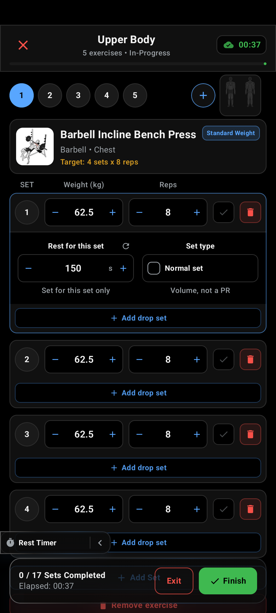
</p>

### Drop sets

A drop set is a direct child of one main set. It is stored with a stable set UID, a parent UID and a
1-based drop index, so it survives drafts, backups and history without relying on row positions.

- Main sets keep `1..N`; each branch numbers its children `D1..DN`.
- Completing a child completes its parent; un-completing a parent clears its children.
- Deleting a parent removes its children; deleting a child leaves its siblings alone.
- Drop defaults can be configured per main set in the Routine editor.
- History shows the branch under its parent instead of counting drop children as extra top-level
  sets.

<p align="center">
  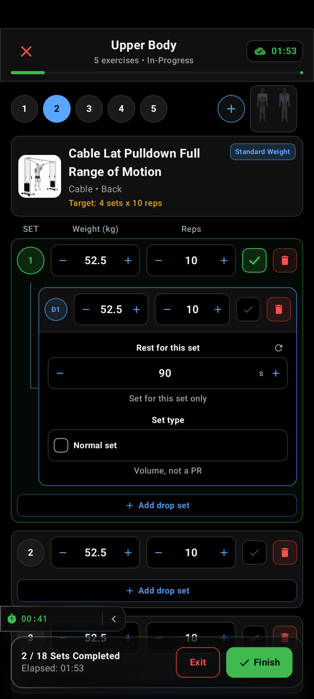
  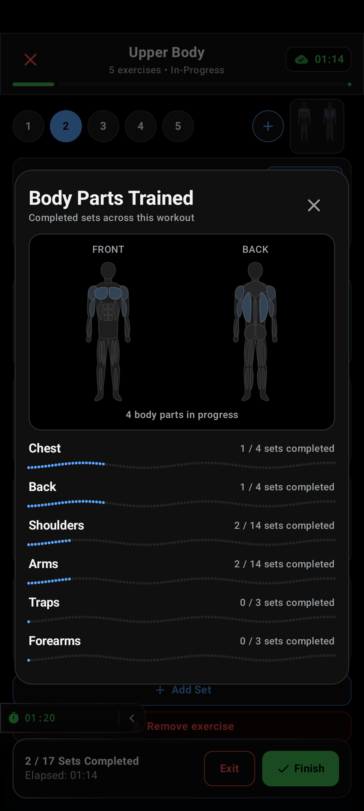
</p>

### Warm-up sets and per-set rest

Every set stores `isWarmup` and an optional `restSecondsOverride`.

- Warm-ups remain visible in history and count toward total volume, but they never become a max-rep,
  estimated-1RM or working-set record.
- A non-zero set rest applies only to that set and starts the timer when it is completed. Resetting
  the override restores the inherited Routine/exercise default.
- A set can also inherit the device-local per-exercise default rest, which seeds Quick Workout sets
  and new Routine entries. A rest saved on the Routine still wins.

### Quick Workout

Quick Workout is the same interface in a resizable, non-modal tray. It can be minimized, half-height
or full-height, keeps the selected exercise and scroll position across tab changes, and uses the
same set rows, drop sets, warm-up toggle and rest timer as a Routine workout.

<p align="center">
  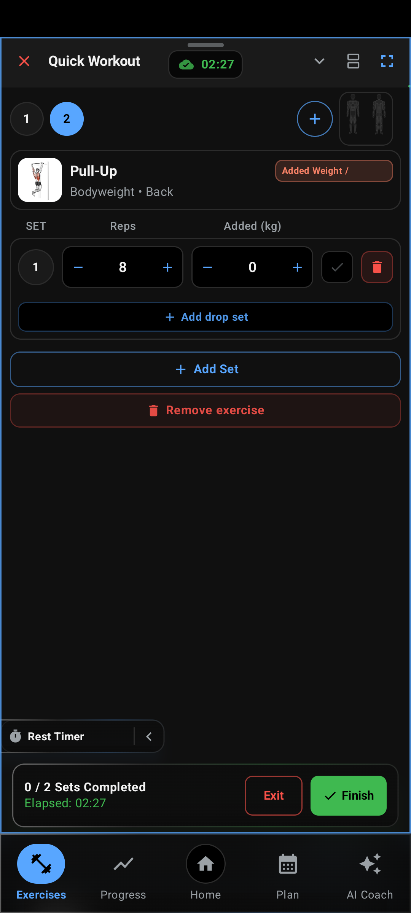
</p>

---

## Exercise library and explicit fields

The app ships **1,334 exercises**. Every row has equipment, category, body part, target muscles,
secondary muscles and instructions. Animations stream from the dataset and are cached; list
thumbnails use the static 180×180 JPG so the first scroll stays cheap.

The body-part picker is an interactive front/back anatomical map. Its regions highlight with the
current accent and filter the list by the same `MusclePart` metadata the database uses.

<p align="center">
  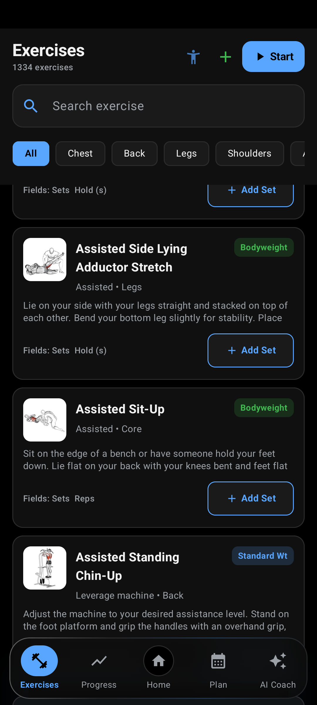
  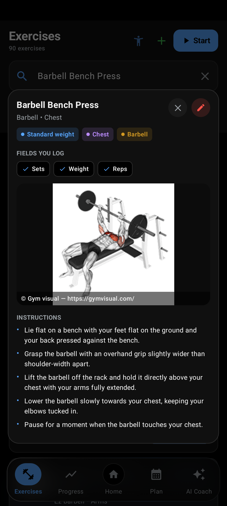
</p>

### One field list per exercise

The type (`Standard weight`, `Added weight`, `Bodyweight`, `Cardio`) supplies a default and the
badge, but the explicit field list is authoritative:

| Field | Meaning |
|---|---|
| `reps` | Repetitions |
| `weight` | External load in kilograms |
| `addedWeight` | Load added on top of body weight |
| `holdSeconds` | Isometric hold |
| `timeSeconds` | Timed work such as cardio |
| `distanceKm` | Distance |

The first two configured fields render inline; the rest appear in the set details. Hold and time
share one stored duration column, so they cannot both be configured. Weight and added weight are
mutually exclusive for the same reason.

**Create Exercise** and **Edit Exercise** expose the full field selector with a live preview of what
will be inline and what will be expanded. The exercise type no longer removes fields the athlete
chose. Custom media is copied into app-private storage and keeps working after a restart.

<p align="center">
  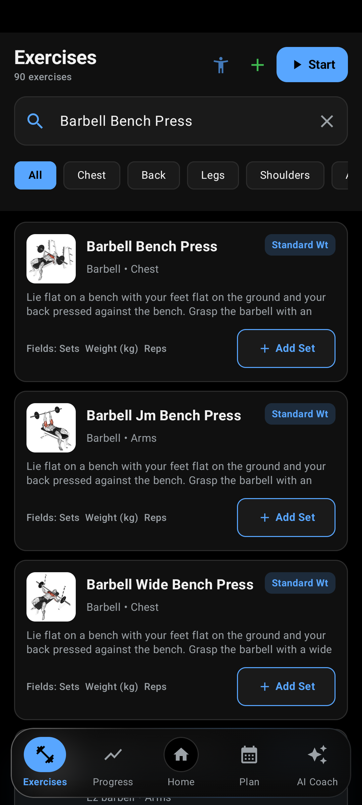
</p>

---

## Home, the week and the streak

Home is the first screen after onboarding and on every later launch. It answers the questions the
athlete has before training:

- **Today's workout** is the active Schedule's assignment for today, with Start Workout. A rest day
  says so and offers another workout. No Schedule asks the athlete to choose one. A running session
  offers Resume rather than starting a second session.
- **Your week** shows all seven days with their dates, planned Routine or rest day, and exercise
  counts. Tapping a training day starts it.
- **The streak** measures adherence to the planned week, not consecutive gym visits. A planned day
  counts when a completed linked session has at least one completed set. Rest days do not break it;
  missed planned days do; today's unfinished plan is pending. The card shows current/best streak, a
  12-week heat map, Done/Missed/Best/Next totals and an alive or burnt-out flame.
- **Last 7 days** covers volume or duration, and tapping a day shows what was trained.
- **This week** reduces the week to workouts, time and volume.
- **Body weight** shows the latest weigh-in, the change since the previous one and Log Weight.
- **Last workout** expands in place with exercise names, one line per logged set and a full-history
  link.
- **Home widgets** can be reordered, hidden, restored, given a weekly goal or given a motivation
  photo. The layout and photo survive restarts and updates.

<p align="center">
  
  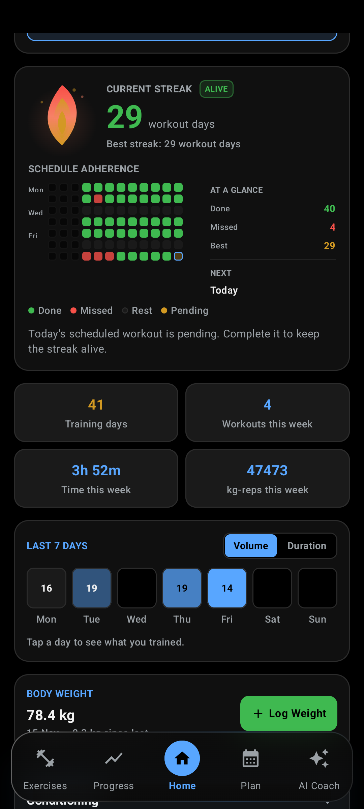
  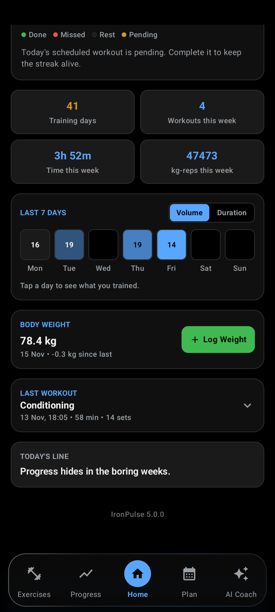
</p>

### Android launcher widgets

Three real launcher widgets are registered separately from the in-app Home cards:

- **Workout Streak (2x2)** — current/best streak and the flame.
- **Weekly Workout Overview (4x2)** — seven binary training days, today's workout and a Start action.
- **Workout Profile (4x2)** — name, weight, height and BMI.

Each has its own **Light**, **Dark**, **AMOLED Dark** or **IronPulse** appearance, independent of the
app theme. Widgets refresh after workouts, plan/profile/theme edits, imports, boot and timezone
changes.

<p align="center">
  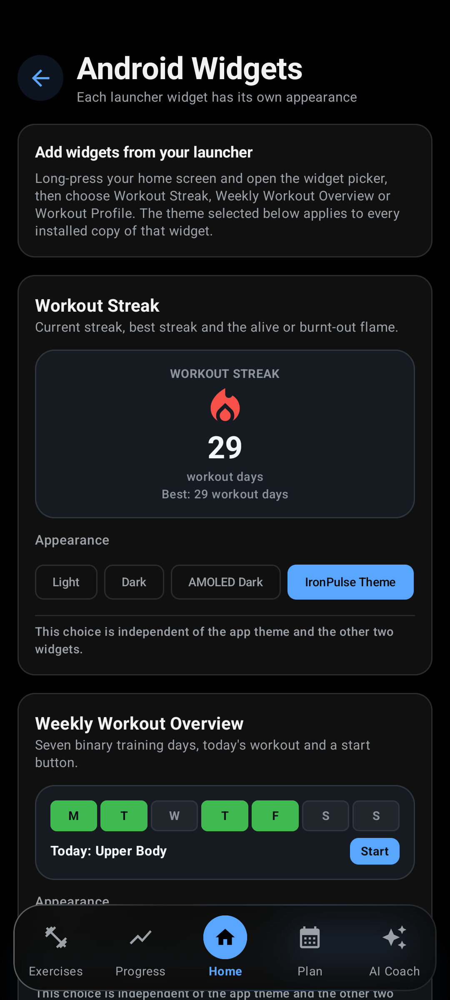
</p>

---

## Progress and history

Progress combines four views:

- **Activity heat map** for the last 12 months, with Time/Volume coverage. The selected month survives
  vertical scrolling.
- **Body Weight Timeline** with a target reference line, the latest change and tappable nodes.
- **Weigh-in Logs** grouped with the timeline, with stable spacing in both collapsed and expanded
  states.
- **Exercise Progression** for one exercise: muscle illustration, estimated 1RM / max reps / total
  volume, an isolated-weight tag, all-time best, latest, sets logged, the graph and the optional AI
  Monthly Summary.

Session History starts collapsed and pages five logged days at a time. Warm-ups carry a `WARM` badge;
drop sets stay under their parent branch.

<p align="center">
  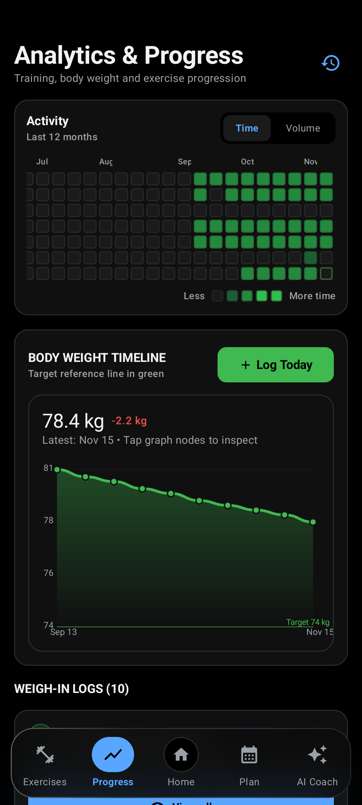
  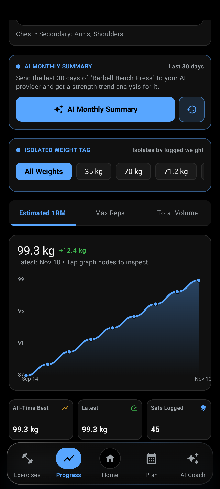
</p>

<p align="center">
  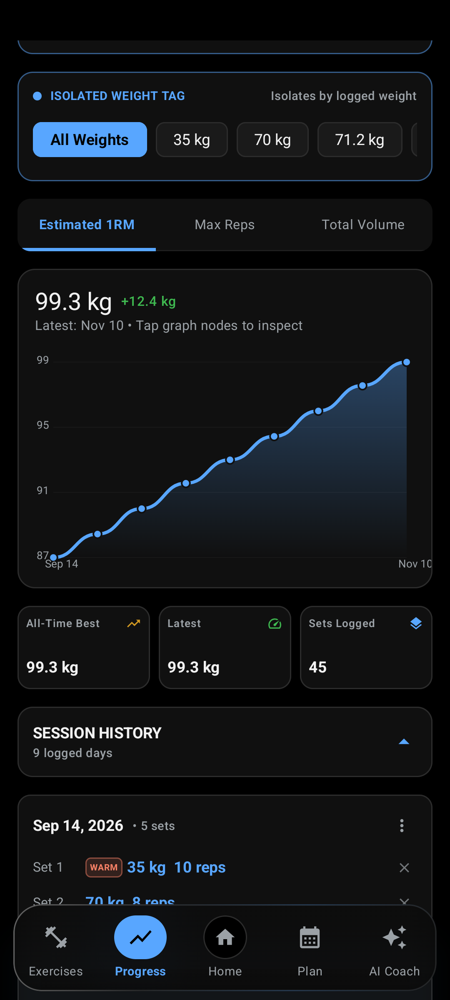
</p>

### How the numbers are defined

- **Volume** uses the load actually lifted. Any recorded added weight contributes.
- **Warm-up sets** remain volume but are excluded from max reps, estimated 1RM and working-set PRs.
- **Drop sets** are children, not extra top-level sets.
- **Hold-only and distance sets** do not invent reps, volume or a 1RM.
- **Body weight is frozen at the set.** A later weigh-in never rewrites what a past set was performed
  at; the repair only fills snapshots that are still zero.
- **Units are display-only.** Everything is stored in kilograms; switching units never rewrites
  history.

---

## AI Coach (optional, bring your own provider)

The app is fully usable without AI. When enabled, **AI Coach** has two pages:

### AI Coach Chat

A database-aware coach with an optional, permission-gated view of training data. Eleven bounded tools
are available:

- Nine read-only tools cover the exercise catalogue, exercise details, saved Routines, the active
  Schedule, recent workouts, one exercise's history and the live workout.
- Two proposal tools can prepare a routine substitution or a complete new routine. They cannot apply
  themselves; the change appears as an approval card and requires a fresh permission check, active
  plan check, stale-signature check and one transaction.

AI workout-data access is **off by default**. Until it is enabled, the personal-data tools are not
registered and the coach receives no hidden workout context.

### Routine Generator

Choose a goal, the number of training days and the available equipment. The generator creates a plan
from movements the catalogue actually has, fills in stable exercise ids and previews the structured
result. **AI Parser** accepts pasted text or JSON.

A multi-day result becomes standalone Routines plus a Schedule; a single-workout request becomes one
Routine and no Schedule. Missing movements can be created as AI-generated exercises, always labelled
as such and never as the athlete's own.

### Providers and summaries

- Google, OpenAI, Anthropic, OpenRouter, xAI or a custom OpenAI-compatible endpoint.
- Per-provider model choice with live discovery or a typed model id.
- Auto, Native only or Text fallback tool modes.
- Saved **AI Monthly Summaries** per exercise, stored offline.
- Immutable **post-workout summaries** that compare against the previous comparable session and
  reopen from history without another request.
- A red warning under Post-workout AI summaries when the active provider has no key or endpoint, with
  a direct Connect a provider action.

<p align="center">
  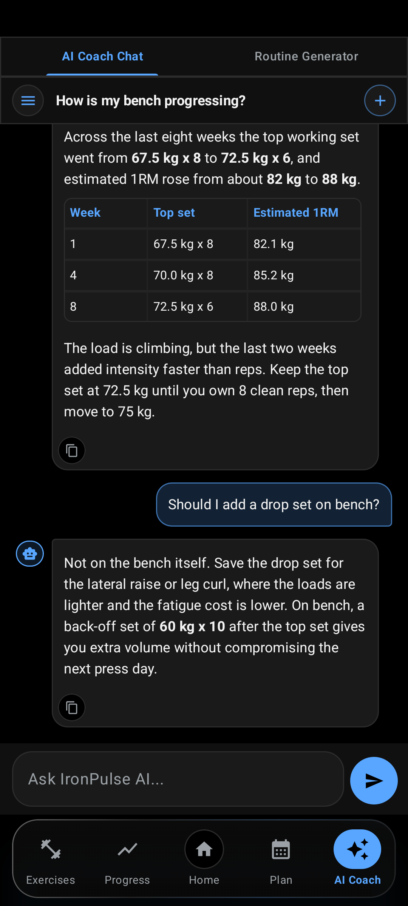
  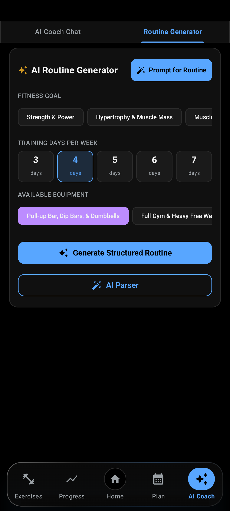
</p>

<p align="center">
  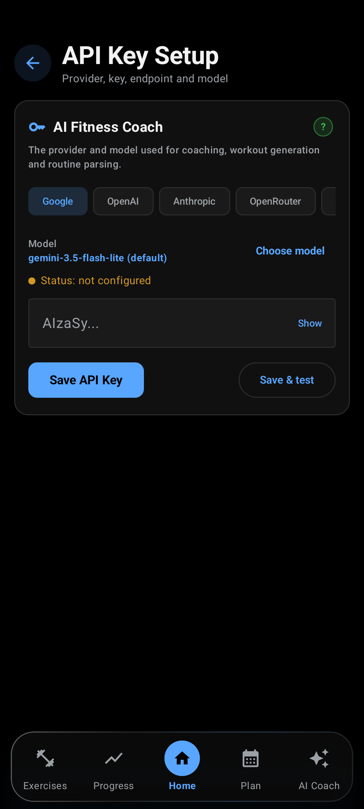
</p>

### Privacy of AI features

- Keys live in app-private DataStore and are sent only to the provider that owns them.
- Athlete-data sharing is off until explicitly enabled.
- AI workout-data access is a separate switch, also off by default; disabling it removes the
  personal-data tools and invalidates pending routine approvals.
- A custom endpoint's URL is validated, plain HTTP is limited to loopback or private-network hosts,
  redirects are not followed and TLS checks are never disabled.

---

## Backup, restore and cloud backup

### Portable `.ironpulse` archives

**Settings → Data → Data Management** exports and imports a versioned ZIP archive:

- `manifest.json` carries the container format version, the data-schema version, source app version,
  export time, section paths and record counts.
- `checksums.json` carries SHA-256 for every payload entry.
- The archive contains profile, preferences, Home layout, custom/edited exercises, all workouts and
  sets, Routines and Schedules, weigh-ins, AI conversations/messages, monthly summaries,
  post-workout summaries and the motivation photo.
- Import shows every file so a `.ironpulse` archive is selectable from any folder or provider; the
  archive validator rejects anything that is not a valid IronPulse backup.
- Import verifies structure, paths, checksums, counts and relationships **before** the destructive
  confirmation. Replacement is transactional with a rollback snapshot; a failure never claims the
  old data was restored unless it was.
- API keys, the profile picture and exercise media are never included; the destination keeps its own
  keys and picture.

Data schema **6** is current. Archives from v1 through v5 migrate forward deterministically.

<p align="center">
  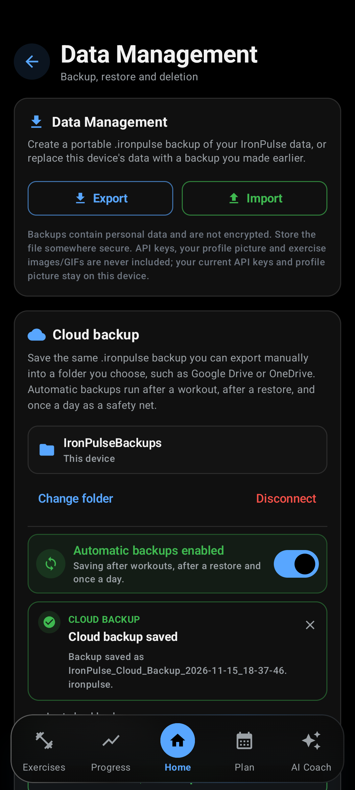
</p>

### Cloud Backup

Choose a folder with Android's system document picker, including Google Drive or OneDrive when their
provider is installed. IronPulse uses the Storage Access Framework; it does not use Google OAuth or
the Drive API.

- The folder permission persists across restarts.
- Automatic backups run after a completed workout, after a restore and after profile/onboarding
  changes, plus a daily WorkManager recovery run.
- Each archive is written to a temporary document, read back, size- and SHA-256-verified, then renamed
  to its timestamped final name.
- A failed attempt is removed and never overwrites an older backup.
- The five newest cloud backups are retained; files created by manual export or by the athlete are
  left alone.
- **Connecting a folder also checks it for existing backups.** If a complete `.ironpulse` archive is
  present, IronPulse asks before restoring it and writes no new file until you decide. This works for
  both manual exports and cloud backups. Restoring during onboarding finishes setup immediately;
  cloud backups wait for a saved profile, so no empty archive is created first.
- Cloud backups are the same unencrypted `.ironpulse` archive. The UI says so and recommends a
  private folder.

<p align="center">
  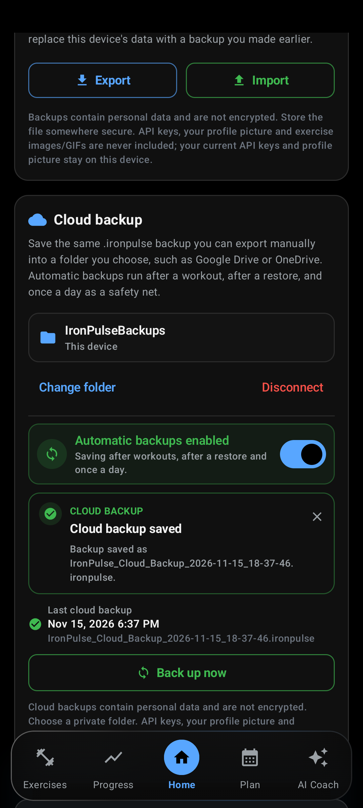
</p>

### Onboarding data step

A new install can import an existing backup or connect a cloud folder before finishing setup. The
step is optional and skippable; the same actions live in Settings.

---

## Appearance and personalization

- **Four themes:** IronPulse, Dark, Light and AMOLED Dark (true black).
- **Accent color:** eight presets plus a custom hue ring, saturation/brightness square, HEX and RGB
  inputs. The choice applies to buttons, tabs, focused fields, checkboxes, sliders, progress
  indicators, selected chips and switches.
- **Liquid Glass:** the floating dock captures and blurs the content behind it on Android 12+, with a
  translucent fallback on older versions. Hold the dock to magnify neighbouring tabs.
- **Fullscreen Mode:** hides the status and navigation bars and respects the display cutout.
- **Material Expressive 3:** accent-coloured countdown-line and completed-set snake animations.
- **Eight launcher icons:** IronPulse, Cool Cyan, Signal Amber, Ultra Violet, Ocean Blue, Crimson
  Red, Rose Quartz and Arctic White. Each ships an adaptive icon, a round variant, legacy density
  bitmaps and a preview. Only one activity alias is enabled at a time, a bootstrap alias keeps a
  fresh install launchable, and Recents follows the selected artwork.
- **Home Tab Widgets** and the three Android launcher widgets keep their own configurations.
- **Per-exercise default rest** is device-local and seeds Quick Workout and new Routine entries.

<p align="center">
  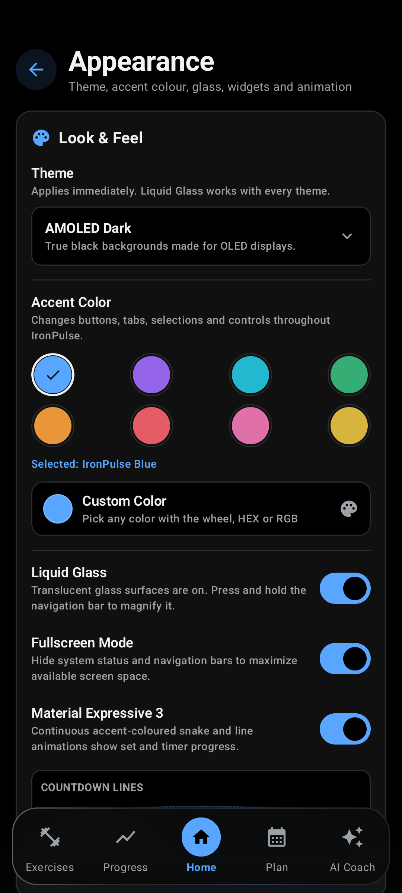
  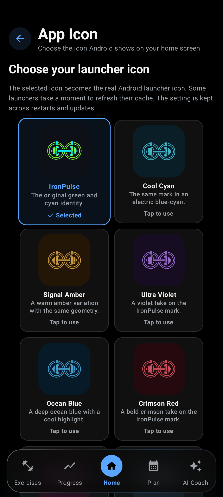
</p>

---

## Profile, settings and updates

The Settings hub starts with the **Athlete Profile** card: name, age, height, current/target weight,
BMI, goal strategy and benchmark records, with an editable avatar. The categories are:

- **Appearance** — theme, accent, Liquid Glass, fullscreen, Material Expressive 3, App Icon and Home
  widgets.
- **User Preferences** — weight unit, week start, autosave interval, rest-timer vibration/sound and
  exercise demos.
- **AI Tools** — data access and provider credentials.
- **Data** — exercise database maintenance, portable backup/restore, cloud backup and Delete App Data.
- **About** — installed version, Check for updates, startup update check and release notes.
- **Support** — ways to support the project.

**Check for updates** reads the public releases of this repository, verifies a downloaded APK against
the published checksum and the package inside the file, and hands it to the Android installer.
Android still asks for install permission. No token or credential is built into the app.

<p align="center">
  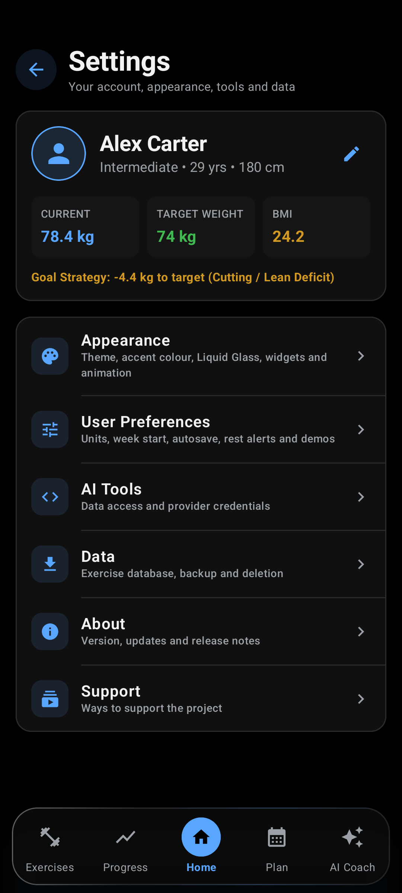
  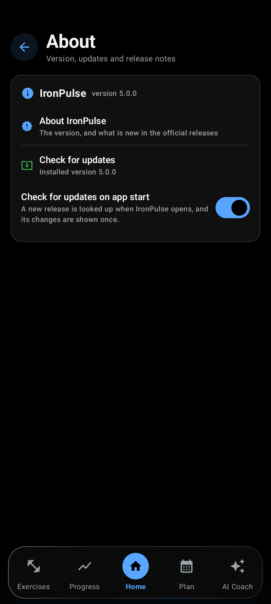
</p>

---

## Privacy

- **No account. No tracking. No analytics.**
- Workouts, weigh-ins, routines, schedules and AI history live in a local SQLite database.
- AI features are optional. Hosted providers require your own API key; a local OpenAI-compatible
  endpoint may not. Keys stay in app-private DataStore and go only to the provider that owns them.
- AI workout-data access and athlete-data sharing are separate switches, both off by default.
- **Delete App Data** wipes the database, preferences, AI keys, summaries, Home layout, widget photos
  and the profile picture. The shipped exercise library and custom exercises are kept.
- Backups are portable but **not encrypted**. API keys, the profile picture and exercise media are
  excluded; store the file somewhere private.
- The update check reads only the public GitHub releases of this repository.

---

## Compatibility and upgrading from 4.4.0

| | |
|---|---|
| Package | `com.aistudio.fitness.ironpulse` |
| Version | **5.0.1 (14)** |
| Minimum Android | 7.1 (API 24) |
| Target / compile SDK | 36 |
| Database | Room 19 |
| Backup data schema | 6 |
| Signing | The same production key as every public release |

- **Public 4.4.0 installs upgrade in place.** The package and signing certificate are unchanged, so
  Android keeps the database. Room migrates 15 → 19, each legacy multi-day routine becomes a
  Schedule plus standalone Routines, and completed sessions and sets are preserved.
- **Public 5.0.0 installs upgrade in place to 5.0.1.** No schema or backup-format change; the update
  only replaces the onboarding/backup code.
- **Backups from 4.4.0 and earlier** import through the v1-v6 migration chain. A schema-2 4.4.0
  archive was restored into a fresh 5.0.1 install during release validation, including its logged
  sets and active Schedule.
- **Internal debug builds 13-25** were never public and were debug-signed. A device carrying one must
  uninstall it before installing the release-signed 5.0.1. Public 4.4.0 and 5.0.0 are unaffected.
- **Not carried in backups:** API keys, the profile picture, exercise media, per-exercise rest
  defaults and the launcher-icon choice.

---

## Install and build from source

### Requirements

- JDK 17 or newer (the Gradle daemon is configured for a compatible JVM)
- Android SDK with platform 36
- A device or emulator on Android 7.1 (API 24) or newer

### Build

```bash
git clone https://github.com/JuggyBob/IronPulse.git
cd IronPulse
./gradlew assembleDebug
```

The APK lands in `app/build/outputs/apk/debug/`. Install it with:

```bash
./gradlew installDebug
```

Android Studio users can open the project and run the `app` configuration. `local.properties` is
created by Android Studio; otherwise copy `local.properties.example` and set `sdk.dir`.

### Release signing

The Gradle release configuration reads the signing inputs from environment variables, so no secret
needs to appear in a command line or a repository file:

| Variable | Purpose |
|---|---|
| `KEYSTORE_PATH` | Absolute path to the release keystore |
| `STORE_PASSWORD` | Keystore password |
| `KEY_ALIAS` | Key alias (defaults to `ironpulsekey`) |
| `KEY_PASSWORD` | Key password |

Never commit the keystore, a password file, `.env`, `local.properties` or a signing log.

### Tests and lint

```bash
./gradlew testDebugUnitTest     # 908 JVM/Robolectric tests across 120 suites
./gradlew lintDebug             # lint gates the build
```

---

## Download

Prebuilt APKs are attached to the
[releases page](https://github.com/JuggyBob/IronPulse/releases). The 5.0.1 release also carries its
SHA-256 file and source/documentation archives.

| Version | File |
|---|---|
| **v5.0.1** | [`IronPulse-5.0.1.apk`](https://github.com/JuggyBob/IronPulse/releases/download/v5.0.1/IronPulse-5.0.1.apk) |
| v5.0.0 | [`IronPulse-5.0.0.apk`](https://github.com/JuggyBob/IronPulse/releases/download/v5.0.0/IronPulse-5.0.0.apk) |
| v4.4.0 | [`IronPulse-4.4.0.apk`](https://github.com/JuggyBob/IronPulse/releases/download/v4.4.0/IronPulse-4.4.0.apk) |
| v4.3.0 | [`IronPulse4.3.0-release.apk`](https://github.com/JuggyBob/IronPulse/releases/download/v4.3.0/IronPulse4.3.0-release.apk) |
| v4.2.0 | [`IronPulse4.2.0-release.apk`](https://github.com/JuggyBob/IronPulse/releases/download/v4.2.0/IronPulse4.2.0-release.apk) |
| v4.1.0 | [`IronPulse4.1.0-release.apk`](https://github.com/JuggyBob/IronPulse/releases/download/v4.1.0/IronPulse4.1.0-release.apk) |
| v4.0.0 | [`IronPulse4.0.0-release.apk`](https://github.com/JuggyBob/IronPulse/releases/download/v4.0.0/IronPulse4.0.0-release.apk) |
| v3.0.0 | [`IronPulse3.0.0-release.apk`](https://github.com/JuggyBob/IronPulse/releases/download/v3.0.0/IronPulse3.0.0-release.apk) |

Every release is signed with the same key, so a newer public version installs over the previous one
and keeps its history. Compare the downloaded file with the published `.sha256` before installing an
APK you did not build.

---

## Tech stack

| Component | Technology |
|---|---|
| **Language** | Kotlin 2.2 (100%) |
| **UI** | Jetpack Compose + Material 3, portrait-only |
| **Architecture** | MVVM: Compose screens → `MainViewModel` facade → nine feature controllers / repositories → Room DAOs |
| **Database** | Room (SQLite), schema 19, versioned migrations |
| **Preferences** | DataStore |
| **Backup format** | `.ironpulse` ZIP with manifest, format/data-schema versions, SHA-256 checksums and forward migrations |
| **Async** | Coroutines + Flow |
| **Images** | Coil (animated GIF and still-frame loaders) |
| **Video** | Media3 / ExoPlayer |
| **AI** | Provider-independent layer in `data/ai`; Google, OpenAI, Anthropic, OpenRouter, xAI and custom OpenAI-compatible endpoints |
| **Updates** | GitHub Releases REST API; no token, official repository only |
| **Min / target SDK** | 24 / 36 |

The nine feature owners are `RestTimerController`, `AppUpdateController`, `DataTransferController`,
`AiConfigurationController`, `HomeDashboardController`, `ProgressAnalyticsController`,
`QuickWorkoutSessionController`, `RoutineWorkoutSessionController` and `PlanController`.

The controller split and data flow are documented in [docs/ARCHITECTURE.md](docs/ARCHITECTURE.md).

---

## Project layout

```text
IronPulse/
├── app/
│   ├── src/main/
│   │   ├── assets/exercises.json       # 1,334-movement catalogue seed
│   │   ├── java/com/example/
│   │   │   ├── data/                   # Room, preferences, repository, backup, cloud backup, AI
│   │   │   ├── ui/
│   │   │   │   ├── components/         # Dialogs, editors, charts, glass, widgets
│   │   │   │   ├── screens/            # Home, Exercises, Progress, Plan, AI Coach, Settings
│   │   │   │   ├── theme/              # Palettes, type, Material 3
│   │   │   │   └── viewmodel/          # MainViewModel facade + nine controllers
│   │   │   ├── util/                   # Coil loaders, media, timers, launcher icons
│   │   │   └── widget/                 # Android launcher widgets
│   │   └── res/                        # Icons, strings, themes, backup rules
│   └── src/test/                       # 906 JVM tests (JUnit + Robolectric)
├── docs/
│   ├── screenshots/5.0.0/              # Final 5.0 screenshots used below and in the README
│   ├── ARCHITECTURE.md
│   ├── DATABASE.md
│   ├── BACKUP_FORMAT.md
│   ├── BACKUP_ARCHITECTURE.md
│   ├── BACKUP_MIGRATION_GUIDE.md
│   ├── CLOUD_BACKUP_ARCHITECTURE.md
│   ├── AI_TOOLS.md
│   └── USER_DATA_INVENTORY.md
├── tools/                              # Exercise-field audit and launcher-icon generation
├── scripts/                            # Dataset and release helpers
├── CHANGELOG.md
├── CONTRIBUTING.md
├── SECURITY.md
├── LICENSES/                           # Preserved historical and new licence texts
└── LICENSE                             # Licensing index (CC BY-NC-SA 4.0 + PolyForm)
```

---

## Credits

- Exercise animations are © [Gym visual](https://gymvisual.com/) and stream from the
  [hasaneyldrm/exercises-dataset](https://github.com/hasaneyldrm/exercises-dataset) repository. The
  required attribution is shown on-screen next to every dataset animation.
- Built with [Jetpack Compose](https://developer.android.com/jetpack/compose) and
  [Material 3](https://m3.material.io/).

## Contributing

Bug reports, feature requests and pull requests are welcome — see [CONTRIBUTING.md](CONTRIBUTING.md).
Security issues go through [SECURITY.md](SECURITY.md) instead of a public issue.

## License

IronPulse has a licensing boundary; it is not under one set of terms across its whole history.

- Code and assets at or before the 3.0.0 boundary remain under the **Creative Commons
  Attribution-NonCommercial-ShareAlike 4.0 International Public License (CC BY-NC-SA 4.0)**. The
  complete preserved text is [LICENSES/CC-BY-NC-SA-4.0.txt](LICENSES/CC-BY-NC-SA-4.0.txt).
- New standalone source files authored after the verified `v3.0.0` tag are under the **PolyForm
  Noncommercial License 1.0.0**. The official text is
  [LICENSES/POLYFORM-NONCOMMERCIAL-1.0.0.txt](LICENSES/POLYFORM-NONCOMMERCIAL-1.0.0.txt).
- Modifications inside pre-existing files are not relicensed as a whole and remain under
  CC BY-NC-SA 4.0, including its ShareAlike requirement.
- Third-party components keep their own licenses.

The official boundary is tag `v3.0.0` at commit `784fc4d3553dc286db85e576641e4f067993f577`
(version name `3.0.0`, version code `7`). [LICENSE](LICENSE) is the index; the evidence and full file
scope are in [LICENSES/LICENSE-BOUNDARY.md](LICENSES/LICENSE-BOUNDARY.md).

**Not an official product of Google, Gym visual, or any exercise dataset author.**
