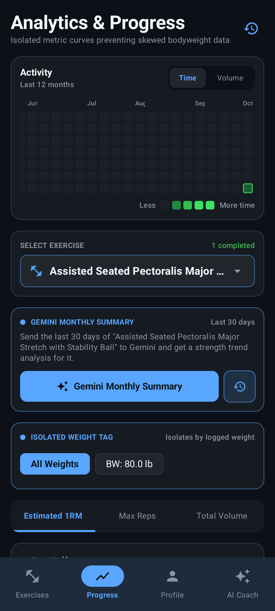
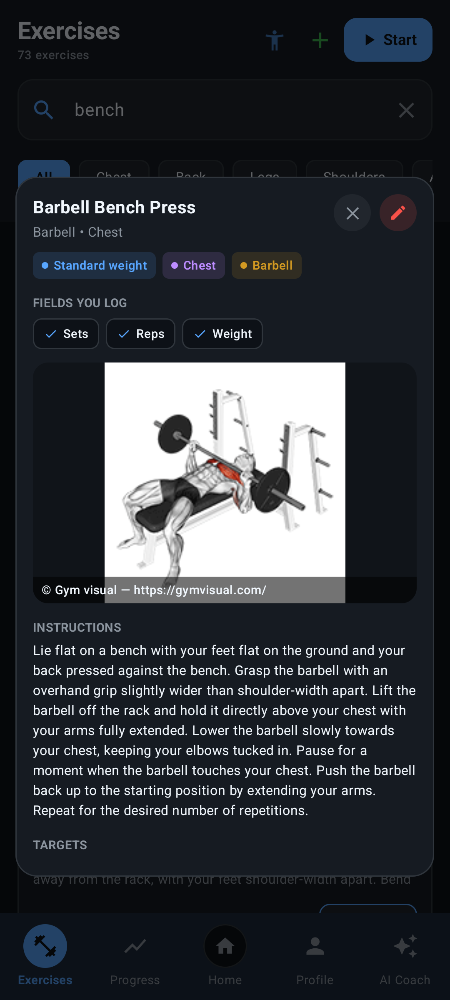
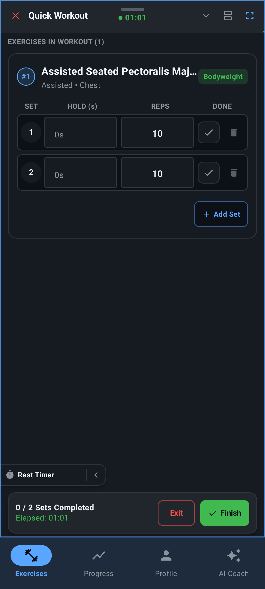
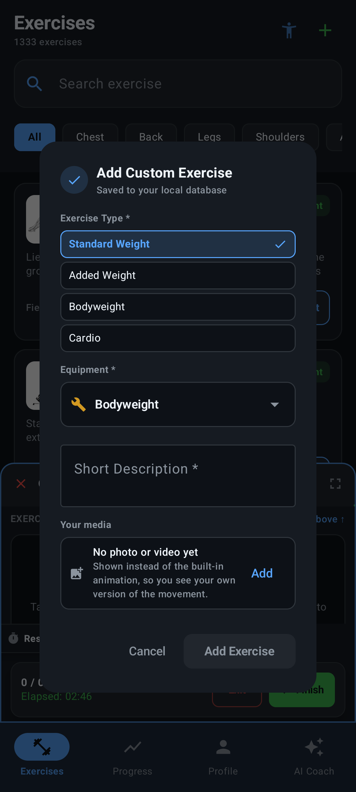
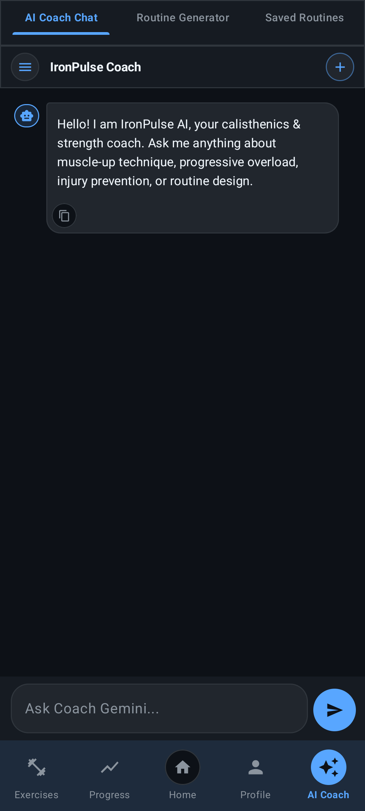
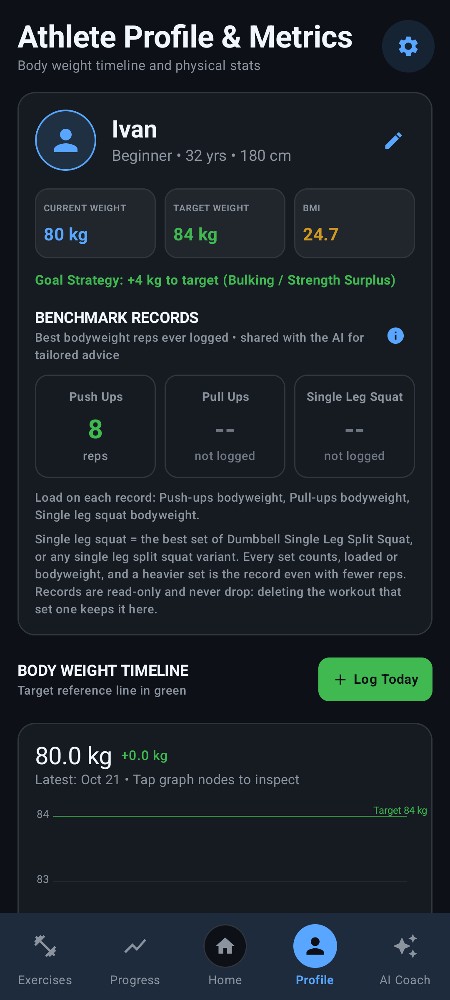

# IronPulse — Workout Logger

[](LICENSE)
[](https://kotlinlang.org)
[](https://developer.android.com)
[](https://github.com/JuggyBob/IronPulse/releases)

A dark-themed workout logger for strength training and calisthenics, built for the gym:
offline by default, no account, no tracking, and a 1,300+ movement catalog that streams its
animations on demand instead of shipping them in the APK.

<p align="center">
  
  
  
</p>

---

## What it does

### Exercise library
1,333 movements seeded into a local SQLite database — every exercise with its equipment, muscle
group, body part, target muscles and coaching instructions. The animation GIFs are **streamed and
cached**, not bundled, so the app stays small and an exercise you never open costs nothing.

<p align="center">
  
</p>

### Logging
- **Quick workouts** — tap *Start*, add exercises, log sets. A live tray keeps the session in view.
- **Routine workouts** — follow a saved split day by day.
- **Every set type is a first-class citizen.** Standard weight, added weight, pure bodyweight and
  cardio each have their own fields, their own column headers and their own Progress-tab
  description. Cardio logs minutes and distance and never asks for a barbell weight.
- Rest timer with vibration and sound, autoplaying or hidden into the border.
- Every exercise is editable — including the shipped library — so a row with wrong fields can be
  fixed instead of being lived with. Library edits ask first and survive catalog updates.

<p align="center">
  
</p>

### Your own exercises
- Attach a photo or video of your own variation. It replaces the built-in animation, so you see
  *your* movement rather than someone else's.
- The pick is copied into the app's own storage, so it keeps working after a restart rather than
  expiring with the gallery's permission.

<p align="center">
  
</p>

### Progress
- Volume, estimated one-rep max, max reps, training streak and a 12-month activity heatmap.
- Per-exercise analysis with an interactive graph you can tap to inspect any point.
- Weigh-ins on the Profile tab, plotted over time, feeding every body-weight calculation in the app.
- Units follow your preference everywhere; the storage unit never changes and no history is ever
  rewritten when you switch.

<p align="center">
  
</p>

### AI (optional, bring your own key)
The app is fully usable without Gemini. Add a key and you get:
- Paste any workout in any format and get a structured routine back.
- Describe a goal and get a plan built from movements the app actually has.
- A coach chat that answers questions about the session you just logged.
- Automatic creation of missing movements, including target muscles, secondary muscles and
  short coaching-cue instructions.
- **Data sharing is off by default.** No part of your profile is sent with a request until you turn
  it on in Settings, and the setting says plainly what is and is not sent.

<p align="center">
  
</p>

### Profile & metrics
Body-weight timeline with a target reference line, BMI, goal strategy, and three read-only
benchmark records (push-ups, pull-ups, single-leg squat) with the load each was done at. Those are
handed to the AI so a progression is based on what you actually lifted.

<p align="center">
  
</p>

---

## Privacy

- **No account. No tracking. No analytics.**
- Every workout, weigh-in and routine lives in a SQLite database on your device.
- AI features are optional and require your own Gemini key.
- Athlete data sharing is **off** until you explicitly enable it.
- "Erase all app data" in Settings wipes everything on the device.

---

## Tech stack

| Component | Technology |
|---|---|
| **Language** | Kotlin (100%) |
| **UI** | Jetpack Compose + Material 3 |
| **Architecture** | MVVM — Compose screens → `MainViewModel` → `FitnessRepository` → Room DAOs |
| **Database** | Room (SQLite), schema v8, versioned migrations |
| **Preferences** | DataStore |
| **Async** | Coroutines + Flow |
| **Images** | Coil (animated GIF + still-frame loaders) |
| **Video** | Media3 / ExoPlayer |
| **AI** | Gemini REST API (`GeminiClient`), bring your own key |
| **Min SDK** | 24 (Android 7.1) · **Target SDK** 35 |

---

## Getting started

### Requirements
- JDK 17 or newer (Android Studio Ladybug / 2024.2+ bundles one)
- Android SDK with platform 35
- A device or emulator on Android 7.1 (API 24) or newer

### Setup
1. **Clone**
   ```bash
   git clone https://github.com/JuggyBob/IronPulse.git
   cd IronPulse
   ```
2. **Point the SDK at your machine.** Android Studio does this for you; otherwise copy
   `local.properties.example` to `local.properties` and set `sdk.dir`.
3. **Build**
   ```bash
   ./gradlew assembleDebug
   ```
   The APK lands in `app/build/outputs/apk/debug/`.
4. **Install on a device**
   ```bash
   ./gradlew installDebug
   ```

### Gemini API key (optional)
The app works fully without one. To enable the AI features, add your key in
**Settings → API Key** at runtime — it is never committed to the repository. For a local
`.env`, copy `.env.example` and fill it in; `.env` is gitignored.

### Running the tests
```bash
./gradlew testDebugUnitTest      # 275 JVM unit tests across 39 classes
./gradlew recordRoborazziDebug   # regenerate reference screenshots
```

---

## Download

Prebuilt APKs are attached to the
[releases page](https://github.com/JuggyBob/IronPulse/releases).

| Version | File |
|---|---|
| **v1.0.1** | [`IronPulse-v1.0.1.apk`](https://github.com/JuggyBob/IronPulse/releases/download/v1.0.1/IronPulse-v1.0.1.apk) |
| v1.0.0 | [`IronPulse-v1.0.0.apk`](https://github.com/JuggyBob/IronPulse/releases/download/v1.0.0/IronPulse-v1.0.0.apk) |

Requires Android 7.1 (API 24) or newer.

---

## Project layout

```
IronPulse/
├── app/
│   ├── src/main/
│   │   ├── assets/exercises.json     # 1,333-movement catalog seed
│   │   ├── java/com/example/
│   │   │   ├── data/                 # Room entities, DAOs, repository, seeders
│   │   │   ├── ui/
│   │   │   │   ├── components/       # Dialogs, editors, charts, sheets
│   │   │   │   ├── screens/          # The six tabs + onboarding
│   │   │   │   ├── theme/            # Colours, type, Material 3 theme
│   │   │   │   └── viewmodel/        # MainViewModel — the single source of truth
│   │   │   └── util/                 # Coil loaders, media store, timers
│   │   └── res/                      # Icons, strings, themes, backup rules
│   └── src/test/                     # 275 JVM tests (Robolectric + JUnit)
├── docs/screenshots/                 # Images used by this README
├── gradle/wrapper/                   # Pinned Gradle distribution
├── .github/                          # Issue & PR templates, CI workflows
├── CHANGELOG.md
├── CONTRIBUTING.md
├── SECURITY.md
└── LICENSE                           # CC BY-NC-SA 4.0
```

---

## Credits

- Exercise animations are © [Gym visual](https://gymvisual.com/) and stream from the
  [hasaneyldrm/exercises-dataset](https://github.com/hasaneyldrm/exercises-dataset) repository. The
  required attribution is shown on-screen next to every dataset animation.
- Built with [Jetpack Compose](https://developer.android.com/jetpack/compose) and
  [Material 3](https://m3.material.io/).

---

## Contributing

Bug reports, feature requests and pull requests are all welcome — see
[CONTRIBUTING.md](CONTRIBUTING.md). Security issues go through
[SECURITY.md](SECURITY.md) instead of a public issue.

---

## License

Licensed under the **Creative Commons Attribution-NonCommercial-ShareAlike 4.0 International
Public License (CC BY-NC-SA 4.0)**. See [LICENSE](LICENSE).

**Not an official product of Google, Gym visual, or any exercise dataset author.**